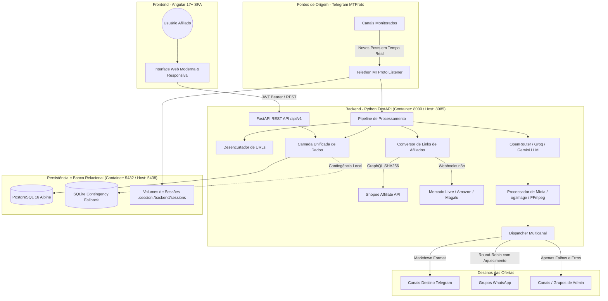

# 🏗️ Arquitetura do Sistema — PardalFlow (Pardal PromoHub)

O **PardalFlow** é uma plataforma distribuída para automação, captura e conversão de ofertas para afiliados, desenhada com foco em alta disponibilidade, performance assíncrona, segurança em camadas e isolamento completo multi-inquilino (*Logical Multi-Tenancy*).

---

## 📐 Diagrama de Arquitetura Atual

---

## 🧩 Componentes Principais

### 1. Frontend (Angular 17+ Standalone SPA)
- **Tecnologias**: Angular 17+, TypeScript, Vanilla CSS Tokens, RxJS, Signals.
- **Filosofia de Design**: Minimalista, moderno, com tema escuro padrão em tons de azul escuro (`#080c16`, `#0f172a`, `#1e293b`) e suporte completo a modo claro via `ThemeService`.
- **Roteamento SPA**: Protegido por `authGuard`, com fallback configurado para Cloudflare Pages via `_redirects` e servidor FastAPI estático.
- **Simulador Interativo**: Prévia de layout das mensagens antes do disparo real com seletor de grupos de destino.
- **Filtros Temporais Inteligentes**: Visualização de métricas por Hoje, Ontem, Semana, Mês ou Todo o período.

### 2. Backend (FastAPI + Async Python)
- **Framework**: FastAPI assíncrono para máxima concorrência e baixa latência.
- **Comunicação em Tempo Real Contínua (Server-Sent Events / SSE)**:
  - Eliminação de requisições contínuas de polling (`setInterval`).
  - O status do bot (`/api/v1/bot/status/stream`) e o streaming de logs (`/api/v1/bot/logs/stream`) utilizam conexões unificadas e reativas via `EventSource`.
  - O servidor notifica instantaneamente o frontend apenas quando há mudança de estado ou eventos (`is_running`, métricas, erros), mantendo a rede silenciosa e sem sobrecarga.
- **Portas de Execução**:
  - **Interna do Container**: `8000`
  - **Host CasaOS / VPS**: `8085` (evitando conflito com portas 8000 de outros apps)
- **Segurança & JWT Dinâmico**:
  - Geração automática de chave de 256 bits (`secrets.token_hex(32)`) caso `SECRET_KEY` não seja fornecida no `.env`.
  - Zero segredos ou credenciais estáticas expostas no código.
- **Camadas**:
  - `app/api/`: Controladores REST desacoplados (auth, bot, channels, destinations, settings, tester, metrics, analytics).
  - `app/core/`: Conexão com banco relacional, segurança criptográfica e configurações de arquitetura.
  - `app/models/`: Validação de esquemas com Pydantic v2.
  - `app/services/`: Serviços de domínio especializados (`BotManager`, `LinkConverterService`, `AIFormatterService`, `DispatcherService`, `MediaProcessorService`).

### 3. Banco de Dados Relacional Exclusivo (PostgreSQL 16)
- **Banco Principal**: PostgreSQL 16 Alpine rodando em container dedicado de alta performance.
  - **Porta Host**: `5438` (evita conflito com o PostgreSQL padrão na 5432).
  - **Volume de Dados**: `/DATA/AppData/pardalflow/postgres` montado em `/var/lib/postgresql/data` (100% persistente e imune a atualizações/pulls de imagem).
  - **Resiliência de Inicialização**: O backend aguarda ativamente a prontidão do socket PostgreSQL durante a inicialização com loop de retry inteligente antes de iniciar as rotas. Zero SQLite.
- **Isolamento Multi-Tenancy**:
  - Todas as tabelas possuem índice e filtro obrigatório por `user_id`:
    - `users`: Usuários e senhas criptografadas (Bcrypt / PBKDF2).
    - `user_configs`: Credenciais de API e modelos privados de cada usuário.
    - `channels`: Canais monitorados com configurações de mídia e tags.
    - `whatsapp_groups`: Grupos de destino com regras de palavras-chave e rodapés.
    - `telegram_destinations`: Canais Telegram com flag de destino administrativo.
    - `whatsapp_sessions`: Sessões WhatsApp para distribuição round-robin.
    - `sent_offers`: Histórico de produtos reais disparados aos destinos.
    - `logs`: Histórico de eventos e auditoria de execução.

---

## 🔒 Princípio de Isolamento do `.env`

O arquivo `.env` do projeto foi projetado estritamente para **arquitetura de infraestrutura**:
- Conexão com o banco (`DATABASE_URL`, `POSTGRES_*`)
- Chave JWT de arquitetura (`SECRET_KEY`)
- Portas e Hosts do servidor (`PORT`, `HOST`)
- Webhooks globais opcionais de microsserviços (n8n)

> [!IMPORTANT]
> **Nenhuma credencial de usuário** (Telegram API ID/Hash, chaves de afiliados Shopee, chaves de IA OpenRouter/Groq/Google) reside no `.env`. Todas as credenciais de terceiros são vinculadas e gerenciadas individualmente por cada usuário através da interface web na aba **Configurações**.
