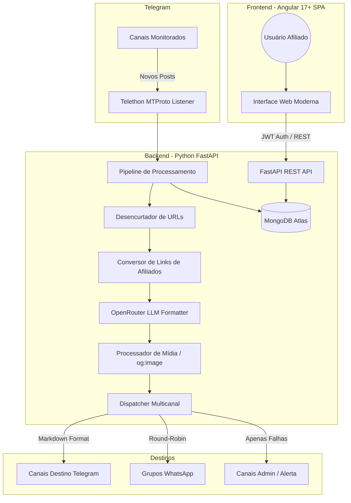

# 🏗️ Arquitetura do Sistema — Pardal PromoHub

O **Pardal PromoHub** é uma plataforma distribuída para gestão de afiliados, desenhada para alta disponibilidade, desacoplamento e isolamento multi-inquilino (*multi-tenancy*).

---

## 📐 Diagrama de Alto Nível

---

## 🧩 Componentes Principais

### 1. Frontend (Angular 17+ Standalone)
- **Tecnologias**: Angular 17+, TypeScript, Vanilla CSS Tokens, RxJS, Signals.
- **Filosofia de Design**: Minimalista, moderno, com tema escuro padrão em tons de azul escuro (`#080c16`, `#0f172a`, `#1e293b`) e suporte completo a modo claro via `ThemeService`.
- **Roteamento SPA**: Protegido por `authGuard`, com fallback configurado para Cloudflare Pages via `_redirects`.

### 2. Backend (FastAPI + Async Python)
- **Framework**: FastAPI assíncrono para máxima performance e baixa latência.
- **Autenticação**: Tokens JWT (HMAC-SHA256) com senhas criptografadas via Bcrypt / PBKDF2.
- **Camadas**:
  - `app/api/`: Controladores REST desacoplados.
  - `app/core/`: Conexão com MongoDB, segurança e configurações globais.
  - `app/models/`: Validação de esquemas com Pydantic v2.
  - `app/services/`: Serviços de domínio reutilizáveis (conversão, IA, mídia, despacho, bot).

### 3. Banco de Dados (MongoDB)
- Coleções estruturadas com chave de inquilino `user_id`:
  - `users`: Credenciais e perfis de usuários.
  - `user_configs`: Modelos de mensagem, prompt de IA e credenciais privadas.
  - `channels`: Canais monitorados com configurações de mídia e tags.
  - `whatsapp_groups`: Grupos de destino com regras de palavras-chave.
  - `telegram_destinations`: Canais Telegram com flag de destino administrativo.
  - `whatsapp_sessions`: Sessões WhatsApp para distribuição round-robin.
  - `logs` e `metrics`: Telemetria e histórico operacional.
